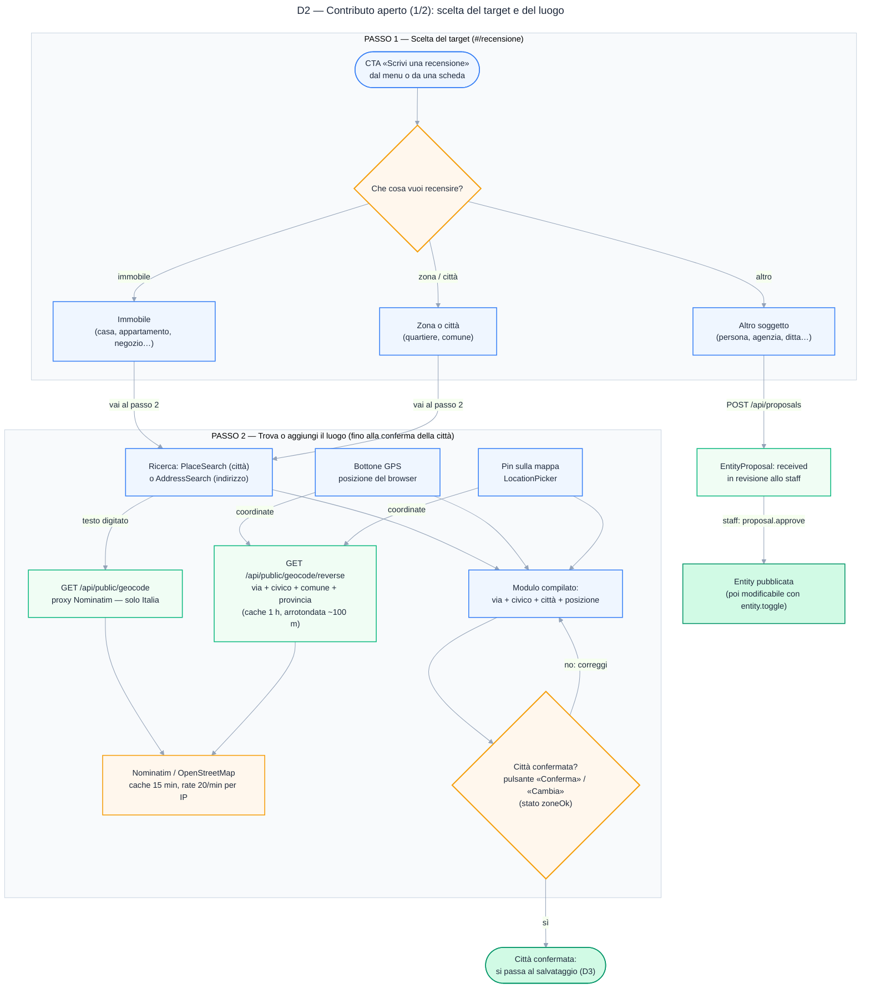
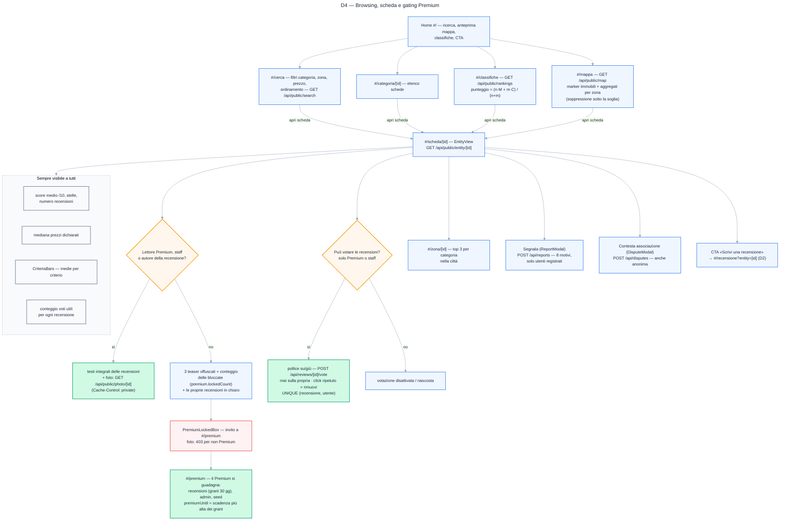
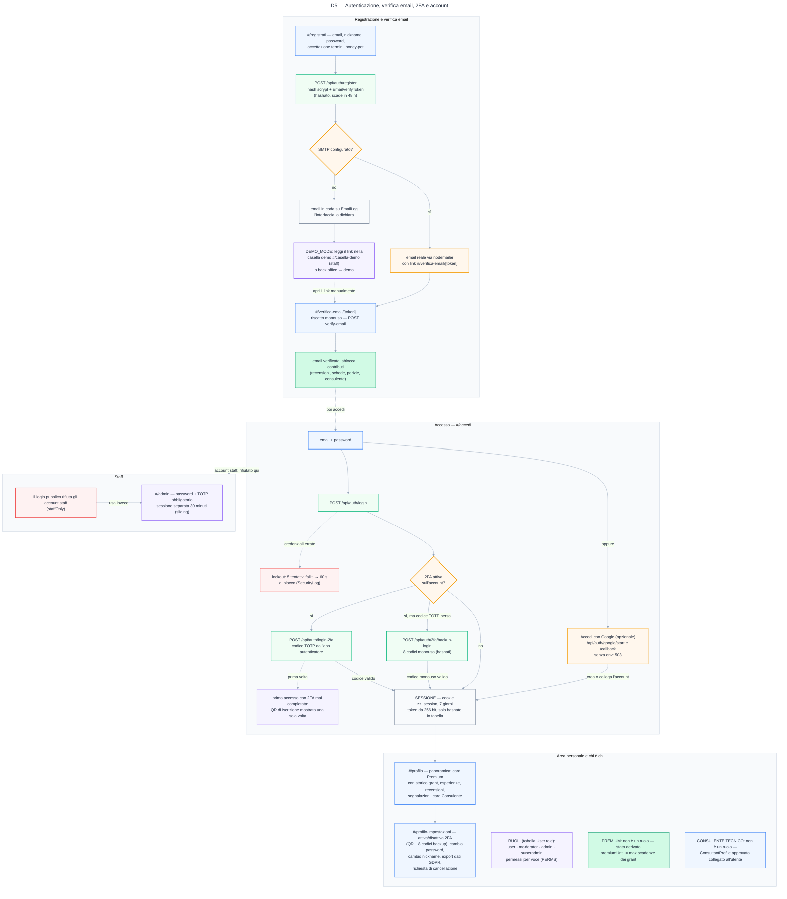
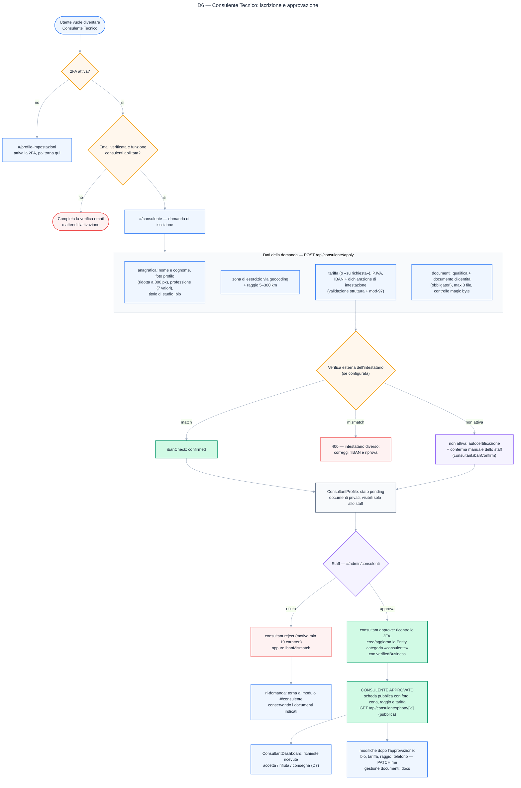
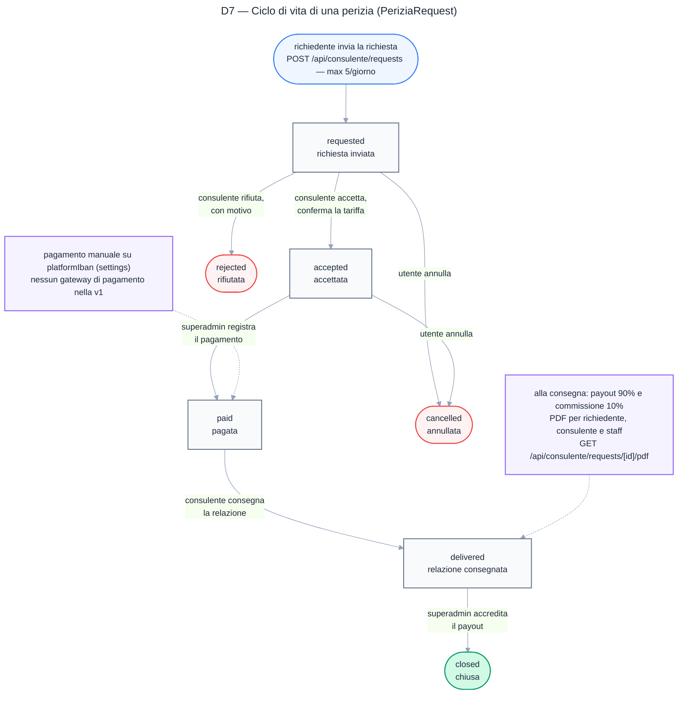
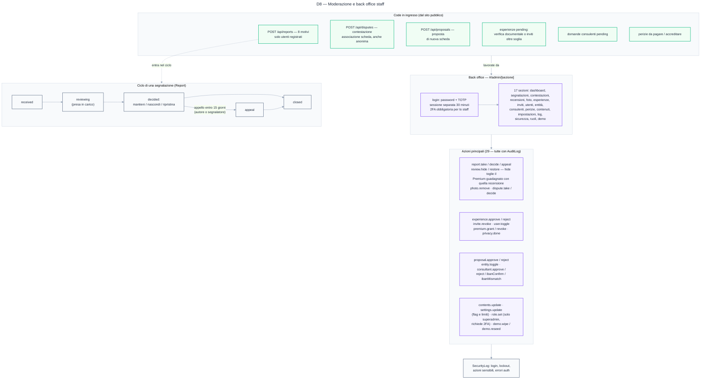
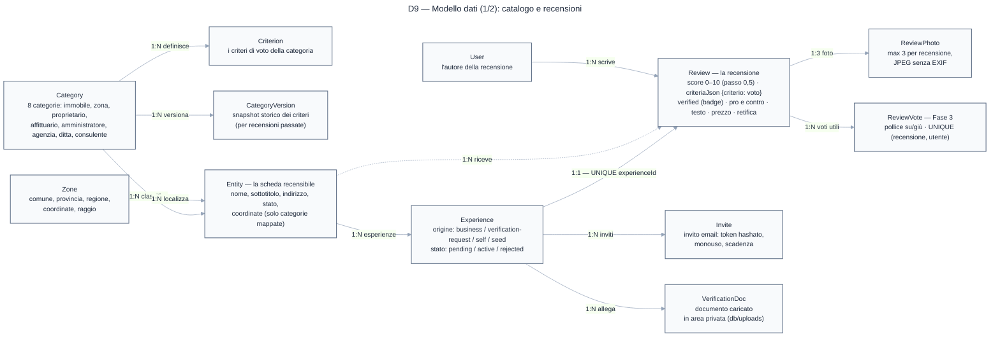
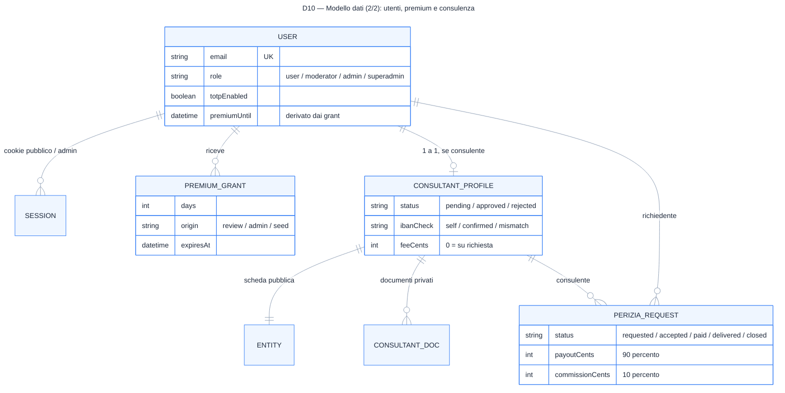

# ZoomZoom — Atlante di funzionamento (diagrammi a blocchi)

> **Versione 1.0 — 22 novembre 2026.** Generato dall'analisi del codice attivo in `src/`.
> Questo documento è la nostra "lingua comune": ogni diagramma ha un codice (**D1…D10**) e ogni
> blocco ha un codice interno (ID dei nodi) che puoi usare per chiedermi modifiche precise.
> Le immagini renderizzate sono in `diagrammi/`; il visualizzatore interattivo è
> `zoomzoom-diagrammi.html` (apribile nel browser, con editing live).

---

## 0. Stato del progetto — che cosa è davvero nel codice

| Blocco | Stato | Note |
| --- | --- | --- |
| Fase 1 — Catalogo aperto | **Completato** | Contributo aperto immobili + zone su tutto il territorio nazionale (geocoding, GPS, dedup, anti-abuso), recensioni dichiarate, ricerca, mappa, classifiche bayesiane |
| Fase 2 — Premium / Freemium | **Completato** | Gating testi/foto, grant/revoca, teaser offuscati, flag `premiumEnabled` dal back office |
| Fase 3 — Community (voti) | **Completato** | Pollice su/giù sulle recensioni, solo Premium/staff, mai sulla propria |
| Consulente Tecnico | **Completato** | Iscrizione con 2FA, approvazione staff, scheda pubblica, richieste di perizia, escrow 90/10, relazione PDF, payout |
| Moderazione | **Completato** | Segnalazioni, appelli (15 gg), contestazioni, proposte, audit/security log, GDPR |
| Invio email reale | **Parziale** | Serve configurare `SMTP_HOST/PORT/USER/PASS/FROM`. Senza SMTP le email finiscono in coda su `EmailLog` e l'interfaccia lo dichiara. In DEMO_MODE si leggono da `#/casella-demo` (staff) o dal back office, sezione *demo* |
| Google OAuth | **Parziale** | Attivo solo con `GOOGLE_CLIENT_ID/SECRET`; senza env il bottone è nascosto e l'API risponde 503 |
| Google AdSense | **Parziale** | Solo con consenso marketing + `adsClient` impostato |
| Verifica intestatario IBAN | **Parziale** | Opzionale con `IBAN_VERIFY_URL/TOKEN`; altrimenti autocertificazione + conferma manuale staff |
| Pagamenti online (gateway) | **Non previsto v1** | Le perizie usano escrow manuale: bonifico su IBAN piattaforma registrato dal superadmin |
| Annunci vendita/affitto, messaggistica, appuntamenti | **Non previsto v1** | Da roadmap futura |

Nota: il codice aggiornato è in `src/`; le cartelle `scripts/*` sono pacchetti di aggiornamento
storici (archivio), non codice attivo.

---

## 1. Convenzioni grafiche (legenda)

Ogni blocco Mermaid è autonomo: la prima parte (frontmatter `--- … ---`) contiene titolo e
configurazione grafica, quindi puoi incollarlo tale e quale in [mermaid.live](https://mermaid.live)
o nel visualizzatore HTML e vedrai lo stesso risultato delle PNG.

**Colori** (definiti con `classDef` all'inizio di ogni diagramma):

| Classe | Colore | Significato |
| --- | --- | --- |
| `ui` | azzurro | Pagine, viste e azioni dell'utente nel browser |
| `api` | verde | API routes lato server (Next.js) |
| `dati` | grigio | Dati, database, file |
| `ext` | ambra | Servizi esterni (Nominatim, SMTP, Google…) |
| `staff` | lilla | Back office staff / amministrazione |
| `esito` | verde scuro | Esiti positivi, pubblicazioni riuscite |
| `blocco` | rosso tenue | Errori, rifiuti, blocchi (409, 403, rifiuto staff) |
| `bivio` | ambra con bordo spesso | Domande/decisioni (nodi a rombo) |

**Forme**: rettangolo = passo/azione · rombo = decisione · pillola (`([…])`) = inizio/fine/esito ·
cilindro (`[(…)]`) = database. **Frecce**: piena = flusso principale; tratteggiata (`-.->`) =
legame debole/opzionale/secondario.

---

## 2. Indice

| Codice | Diagramma | File principali coinvolti |
| --- | --- | --- |
| D1 | Architettura generale | `src/app/page.tsx`, `src/lib/client/router.ts`, `src/app/api/**`, `prisma/schema.prisma` |
| D2 | Contributo aperto (1/2): wizard target + luogo | `src/components/views/write-review-open.tsx`, `place-search.tsx`, `address-search.tsx`, `location-picker.tsx`, `src/app/api/public/geocode/**` |
| D3 | Contributo aperto (2/2): salvataggio + recensione | `src/app/api/entities/route.ts`, `zones/route.ts`, `reviews/route.ts`, `src/lib/server/zones.ts`, `validation.ts`, `premium.ts` |
| D4 | Browsing e scheda (Premium Fase 2 + voti Fase 3) | `src/components/views/entity-zone.tsx`, `map-rankings-category.tsx`, `src/app/api/public/**`, `src/lib/server/review-access.ts` |
| D5 | Autenticazione e account | `src/components/views/auth.tsx`, `profile.tsx`, `src/app/api/auth/**`, `src/lib/server/auth.ts`, `totp.ts`, `mailer.ts` |
| D6 | Consulente Tecnico: iscrizione e approvazione | `src/components/views/consulente.tsx`, `src/app/api/consulente/**`, `src/lib/server/consultants.ts`, `iban-verify.ts` |
| D7 | Consulente Tecnico: ciclo della perizia | `src/app/api/consulente/requests/**`, `src/lib/server/pdf.ts`, modello `PeriziaRequest` |
| D8 | Moderazione e back office | `src/components/admin/admin.tsx`, `src/app/api/admin/**`, `src/lib/server/audit.ts` |
| D9 | Modello dati (1/2): catalogo e recensioni | `prisma/schema.prisma` |
| D10 | Modello dati (2/2): utenti, premium e consulenza | `prisma/schema.prisma` |

---

## D1 — Architettura generale

Vista macro: il browser esegue **una sola pagina** (SPA con hash router, 33 viste) che parla solo
con le API del server; i servizi esterni sono raggiunti **esclusivamente dal server** (tranne i
tile della mappa e gli annunci).

```mermaid
---
title: "D1 — Architettura generale di ZoomZoom"
config:
  theme: base
  themeVariables:
    primaryColor: "#EFF6FF"
    primaryBorderColor: "#3B82F6"
    primaryTextColor: "#1E293B"
    lineColor: "#94A3B8"
    secondaryColor: "#F0FDF4"
    tertiaryColor: "#FFF7ED"
    fontSize: "14px"
    fontFamily: "Helvetica, Arial, DejaVu Sans, sans-serif"
  flowchart:
    curve: basis
    padding: 20
    nodeSpacing: 55
    rankSpacing: 65
    htmlLabels: true
---
flowchart TB

    %% ═══ BROWSER ═══
    subgraph CLIENT["Browser — client"]
        direction LR
        SPA["App ZoomZoom<br>pagina unica / con hash router<br>33 viste — src/app/page.tsx"]:::ui
        MAPPA["Mappa Leaflet<br>src/components/map.tsx"]:::ui
        MEMO["localStorage<br>zoomzoom.miaZona + consensi cookie"]:::ui
    end

    %% ═══ SERVER ═══
    subgraph SERV["Server Next.js — API routes (src/app/api)"]
        direction TB
        PUB["/api/public<br>bootstrap, search, rankings, entity,<br>photo, map, geocode, geocode/reverse"]:::api
        AUTH["/api/auth<br>register, login, login-2fa, 2fa,<br>verify-email, change-password, google"]:::api
        CONTR["Contributo aperto (Fase 1)<br>/api/entities, /api/zones,<br>/api/reviews + rettifica + vote"]:::api
        PERS["Persona, soggetti, verifica<br>/api/me, /api/subject,<br>/api/invitations, /api/experiences"]:::api
        CIV["Segnala e contatta<br>/api/reports, /api/disputes, /api/proposals,<br>/api/contact, /api/consent, /api/diagnostica"]:::api
        CONS["Consulente Tecnico<br>/api/consulente<br>apply, me, docs, photo, requests, action, pdf"]:::api
        ADM["Back office staff<br>/api/admin<br>login, data (17 sezioni), action (29 azioni)"]:::staff
    end

    %% ═══ DATI ═══
    subgraph DATI["Dati"]
        direction LR
        DB[("Prisma 6 + SQLite<br>db/custom.db — 25 modelli")]:::dati
        FILE["Area privata file system<br>db/uploads — documenti di verifica"]:::dati
    end

    %% ═══ SERVIZI ESTERNI ═══
    subgraph EST["Servizi esterni"]
        direction LR
        NOM["Nominatim / OpenStreetMap<br>geocoding + reverse<br>rate 20/min, cache 15 min / 1 h"]:::ext
        TILES["Tile mappa OpenStreetMap<br>richiesti direttamente dal browser"]:::ext
        SMTP["SMTP via nodemailer<br>se configurato, altrimenti coda EmailLog"]:::ext
        GOOG["Google OAuth 2.0<br>opzionale, variabili d'ambiente"]:::ext
        ADS["Google AdSense<br>solo con consenso marketing"]:::ext
        IBANV["Verifica intestatario IBAN<br>opzionale (TrueLayer, Tink, Fabrick…)"]:::ext
    end

    %% collegamenti
    SPA --> MAPPA
    SPA -->|"fetch HTTPS + cookie zz_session"| SERV
    MAPPA -->|"tile della mappa"| TILES
    SPA -.->|"script annunci (solo con consenso)"| ADS
    SERV -->|"Prisma ORM"| DB
    PERS -->|"upload documenti"| FILE
    PUB -->|"geocoding / reverse"| NOM
    CONTR -->|"geocoding / reverse"| NOM
    AUTH -->|"invio email"| SMTP
    AUTH -->|"OAuth 2.0"| GOOG
    CONS -->|"verifica intestatario"| IBANV

    classDef ui fill:#EFF6FF,stroke:#3B82F6,stroke-width:1.5px,color:#1E293B
    classDef api fill:#F0FDF4,stroke:#10B981,stroke-width:1.5px,color:#1E293B
    classDef dati fill:#F8FAFC,stroke:#64748B,stroke-width:1.5px,color:#1E293B
    classDef ext fill:#FFF7ED,stroke:#F59E0B,stroke-width:1.5px,color:#1E293B
    classDef staff fill:#F5F3FF,stroke:#8B5CF6,stroke-width:1.5px,color:#1E293B
    style CLIENT fill:#F8FAFC,stroke:#CBD5E1,stroke-width:1px
    style SERV fill:#F8FAFC,stroke:#CBD5E1,stroke-width:1px
    style DATI fill:#F8FAFC,stroke:#CBD5E1,stroke-width:1px
    style EST fill:#F8FAFC,stroke:#CBD5E1,stroke-width:1px
```



Note: deploy locale dietro Caddy (porta 81 → localhost:3000); esiste anche il deploy Vercel di
produzione (PostgreSQL). Non esiste `middleware.ts`: tutta la protezione è dentro le API routes
(sessione, permessi, same-origin, rate limit).

---

## D2 — Contributo aperto (1/2): wizard, target e luogo

Il flusso più importante del sito (Fase 1): dall'invito «Scrivi una recensione» alla **conferma
della città**, passando per ricerca, GPS o pin sulla mappa. La conferma della città è un passo
obbligato (stato `zoneOk`): il pulsante resta su «Conferma» / «Cambia» finché la località non è
validata.



Perché è così: la conferma esplicita della città evita schede duplicate su comuni omonimi e
coordinate sbagliate; il geocoding passa sempre dal server (cache + rate limit verso Nominatim).

---

## D3 — Contributo aperto (2/2): salvataggio scheda e recensione

Continuazione di D2: creazione della scheda (con dedup) e pubblicazione della recensione, con i
due «badge» (verificata / dichiarata) e la ricompensa Premium (Fase 2).

```mermaid
---
title: "D3 — Contributo aperto (2/2): salvataggio della scheda e pubblicazione"
config:
  theme: base
  themeVariables:
    primaryColor: "#EFF6FF"
    primaryBorderColor: "#3B82F6"
    primaryTextColor: "#1E293B"
    lineColor: "#94A3B8"
    fontSize: "14px"
    fontFamily: "Helvetica, Arial, DejaVu Sans, sans-serif"
  flowchart:
    curve: basis
    padding: 20
    nodeSpacing: 55
    rankSpacing: 65
    htmlLabels: true
---
flowchart TB

    %% ═══ PASSO 3: salvataggio ═══
    subgraph P3["PASSO 3 — Salvataggio della scheda"]
        SENT["POST /api/entities<br>indirizzo + zona + coordinate<br>richiede email verificata"]:::api
        RISOL["Risoluzione della città a gradini:<br>1) zoneId già noto  2) nome + coordinate<br>3) coordinate del pin"]:::api
        ENSZ["ensureZone (dedup):<br>nome + provincia + distanza max 30 km<br>crea la scheda zona se manca"]:::api
        DEDI{"Indirizzo già presente<br>nella stessa città?"}:::bivio
        E409(["409 + existingId:<br>riusa la scheda esistente"]):::blocco
        NEW["Entity immobile pubblicata subito<br>proposta da «user:id», audit log"]:::esito
        SENTZ["POST /api/zones<br>target zona: attiva la località"]:::api
        ZNEW["Scheda zona recensibile<br>ent_z_ + slug"]:::esito
        SENT --> RISOL
        RISOL --> ENSZ
        SENTZ --> ENSZ
        ENSZ -->|"per immobile"| DEDI
        ENSZ -->|"per zona"| ZNEW
        DEDI -->|"sì"| E409
        DEDI -->|"no"| NEW
    end

    %% ═══ PASSO 4: recensione ═══
    subgraph P4["PASSO 4 — Pubblicazione della recensione"]
        FRM["ReviewFields: voto 0–10 (passo 0,5),<br>criteri della categoria → criteriaJson,<br>pro (obbligatori) e contro, testo min 100 caratteri,<br>dichiarazione di onestà, prezzo"]:::ui
        FOTO["PhotoInput: max 3 foto<br>compresse nel browser + sharp<br>EXIF e GPS rimossi, JPEG max 1280 px"]:::ui
        POSTR["POST /api/reviews"]:::api
        DUP{"Recensione già presente dello<br>stesso utente per la stessa scheda?"}:::bivio
        R409(["409 — una recensione<br>per utente per scheda"]):::blocco
        VIA{"Quale via?"}:::bivio
        VER["RECENSIONE VERIFICATA (badge verde)<br>da esperienza attiva: invito del soggetto<br>o verifica documentale — UNIQUE experienceId"]:::esito
        DIC["RECENSIONE DICHIARATA (badge ambra)<br>contributo aperto: crea<br>esperienza origin «self»"]:::ui
        FRM --> POSTR
        FOTO --> POSTR
        POSTR --> DUP
        DUP -->|"sì"| R409
        DUP -->|"no"| VIA
        VIA -->|"esperienza attiva"| VER
        VIA -->|"contributo aperto"| DIC
    end

    NEW -->|"apri il modulo"| FRM
    ZNEW -->|"apri il modulo"| FRM
    E409 -.->|"recensisci la scheda esistente"| FRM

    ESIT["Scheda aggiornata: score medio,<br>medie per criterio, prezzi, mappa, classifiche"]:::esito
    PREM["PremiumGrant (Fase 2):<br>es. 30 giorni, cap 365, audit log"]:::esito
    RETT["Rettifica: #/rettifica/[id] → PUT /api/reviews/[id]<br>solo autore, motivo min 10 caratteri,<br>entro la finestra configurabile (rettificaDays)"]:::ui
    VER --> ESIT
    DIC --> ESIT
    ESIT --> PREM
    ESIT -.->|"rettifica"| RETT

    classDef ui fill:#EFF6FF,stroke:#3B82F6,stroke-width:1.5px,color:#1E293B
    classDef api fill:#F0FDF4,stroke:#10B981,stroke-width:1.5px,color:#1E293B
    classDef esito fill:#D1FAE5,stroke:#059669,stroke-width:1.5px,color:#1E293B
    classDef blocco fill:#FEF2F2,stroke:#EF4444,stroke-width:1.5px,color:#1E293B
    classDef bivio fill:#FFF7ED,stroke:#F59E0B,stroke-width:2px,color:#1E293B
    style P3 fill:#F8FAFC,stroke:#CBD5E1,stroke-width:1px
    style P4 fill:#F8FAFC,stroke:#CBD5E1,stroke-width:1px
```



Limiti anti-abuso (visibili solo in parte nel diagramma): `openReviewsPerDay` (recensioni aperte
al giorno per utente), limiti geografici sull'Italia (`inItalyBounds`), honey-pot sul form.

---

## D4 — Browsing e scheda: gating Premium (Fase 2) e voti (Fase 3)

Come si naviga il catalogo e che cosa vede chi non è Premium: aggregati sempre pubblici, testi
integrali e foto solo a Premium/staff/autore, altrimenti 3 teaser offuscati.



---

## D5 — Autenticazione e account

Dalla registrazione alla sessione, con verifica email (incluso il **percorso demo** per leggere le
email quando SMTP non è configurato), 2FA, lockout e i «ruoli» veri rispetto a Premium/Consulente
che **non** sono ruoli.



Suggerimento per i tuoi test: finché SMTP non è configurato, registra l'account e leggi il link
di verifica dalla casella demo (DEMO_MODE). La 2FA si attiva da `#/profilo-impostazioni`; per lo
staff e per il consulente è obbligatoria.

---

## D6 — Consulente Tecnico: iscrizione e approvazione

La domanda di iscrizione richiede 2FA attiva ed email verificata; lo staff approva e questo crea
automaticamente la scheda pubblica del consulente.



---

## D7 — Consulente Tecnico: ciclo della perizia (macchina a stati)

Stati di `PeriziaRequest` e chi muove ogni transizione: utente, consulente e superadmin hanno
poteri diversi. Il PDF della relazione è scaricabile da `delivered` in poi.



---

## D8 — Moderazione e back office

Le code in ingresso, le 17 sezioni del back office e le 29 azioni staff (tutte tracciate in
AuditLog); in dettaglio il ciclo di vita di una segnalazione con appello.



---

## D9 — Modello dati (1/2): catalogo e recensioni

Il modello dati è diviso in due diagrammi per restare leggibile. Qui: catalogo, esperienze e
recensioni — rappresentati in stile diagramma a blocchi con la cardinalità sulle frecce
(1:N = uno a molti, 1:1 = uno a uno) perché la notazione ER automatica risultava troppo affollata;
D10, più piccolo, usa la notazione ER classica. Non compaiono tutti i campi (vedi
`prisma/schema.prisma`) né i modelli di servizio (elencati in Appendice B).



---

## D10 — Modello dati (2/2): utenti, premium e consulenza

Qui: utente e sessioni, ricompense Premium, profilo consulente e ciclo perizie. `USER` compare
in entrambi i diagrammi perché è il punto di raccordo fra le due aree. Il campo
`User.subjectEntityId` collega inoltre ogni utente alla propria scheda soggetto verificato
(relazione non disegnata per non appesantire il tracciato).



---

## Come modificare i diagrammi (la nostra lingua comune)

### Sintassi Mermaid minima

| Cosa | Come si scrive |
| --- | --- |
| Nodo rettangolare | `ID["etichetta"]` |
| Domanda / decisione | `ID{"domanda?"}` |
| Inizio / fine / esito | `ID(["etichetta"])` |
| Database | `ID[("etichetta")]` |
| Collegamento con etichetta | `A -->|"etichetta"| B` |
| Collegamento debole / opzionale | `A -.->|"etichetta"| B` |
| Più destinazioni | `A --> B & C` |
| Gruppo | `subgraph IDG["Titolo"]` … `end` |
| Colore | aggiungi `:::ui` (o `api`, `dati`, `ext`, `staff`, `esito`, `blocco`, `bivio`) subito dopo la parentesi del nodo |
| Commento (ignorato dal renderer) | riga che inizia con `%%` |

### Come chiedermi una modifica

Basta un messaggio così — io capisco e applico:

1. **Aggiungere**: «In **D2**, dopo il nodo `CONF` aggiungi un controllo che verifica …»
2. **Cambiare un'etichetta**: «In **D3** cambia il testo del nodo `PREM` in …»
3. **Aggiungere una transizione**: «In **D7** aggiungi `PAID --> REFUNDED` con attore superadmin e motivo rimborso»
4. **Eliminare**: «In **D4** elimina il nodo `VNO` e i suoi collegamenti»
5. **Ristrutturare**: «Sposta la sezione consulenti di **D6** in un diagramma nuovo **D10**»
6. **Modifica già pronta**: incollami il blocco ```mermaid``` modificato (da mermaid.live o dal visualizzatore HTML) e scrivimi «applica questo».

Ogni nodo ha un **ID breve** (per esempio `CONF`, `POSTR`, `PREM`): è il codice tra parentesi quadre
all'inizio della riga nel sorgente. Usalo nei tuoi messaggi: mi permette di intervenire
chirurgicalmente senza toccare il resto.

### Cosa faccio io dopo la tua richiesta

1. Aggiorno il blocco nel documento (versione → v1.1, v1.2… registrata nel changelog).
2. Rigenero automaticamente le PNG con lo script `scripts/diagrammi/render_diagrammi.py`.
3. Aggiorno il visualizzatore HTML.
4. Se la modifica riguarda il funzionamento del sito (non solo del diagramma), ti propongo anche
   la modifica al codice in `src/` e te la descrivo prima di applicarla.

---

## Appendice A — Hash route → file delle viste

| Area | Hash route | File |
| --- | --- | --- |
| Pubblico | `#/`, `#/cerca`, `#/mappa`, `#/classifiche`, `#/categoria/[id]`, `#/scheda/[id]`, `#/zona/[id]` | `src/components/views/home.tsx`, `search.tsx`, `map-rankings-category.tsx`, `entity-zone.tsx` |
| Informative | `#/come-funziona`, `#/premium`, `#/privacy`, `#/cookie`, `#/termini`, `#/regole-recensioni`, `#/moderazione`, `#/contatti` | `src/components/views/info-pages.tsx` |
| Recensioni | `#/recensione`, `#/scrivi/[id]`, `#/rettifica/[id]`, `#/invito/[token]`, `#/verifica-esperienza`, `#/area-soggetto`, `#/proponi-soggetto` | `src/components/views/write-review-open.tsx`, `review-flows.tsx` |
| Account | `#/accedi`, `#/registrati`, `#/verifica-email/[token]`, `#/profilo`, `#/profilo-inviti`, `#/profilo-impostazioni` | `src/components/views/auth.tsx`, `profile.tsx` |
| Consulente | `#/consulente`, `#/consulente-richieste`, `#/consulente-richiesta?to=` | `src/components/views/consulente.tsx` |
| Staff / demo | `#/admin/[sezione]`, `#/casella-demo` (solo DEMO_MODE) | `src/components/admin/admin.tsx`, `info-pages.tsx` |

## Appendice B — Modelli del database non raffigurati in D9 e D10

`BackupCode`, `EmailVerifyToken`, `EmailLog`, `Consent`, `ContactRequest`, `PrivacyRequest`,
`Dispute` (+ `DisputeDecision`), `ReportDecision`, `Report` (il suo ciclo è in D8),
`EntityProposal` (il suo flusso è in D2), `AuditLog`, `SecurityLog`, `Setting`. I campi completi
di tutti i 25 modelli sono in `prisma/schema.prisma`.

## Appendice C — Rigenerare le immagini

```bash
python3 /home/z/my-project/scripts/diagrammi/render_diagrammi.py
```

Lo script legge i blocchi ```mermaid``` da questo documento (unica fonte di verità), li renderizza
con `mmdc` (Mermaid CLI) in `diagrammi/D*.png` e rigenera il visualizzatore HTML.

---

## Changelog

| Versione | Data | Modifiche |
| --- | --- | --- |
| 1.0 | 22/11/2026 | Prima stesura: 10 diagrammi generati dall'analisi del codice in `src/` |
